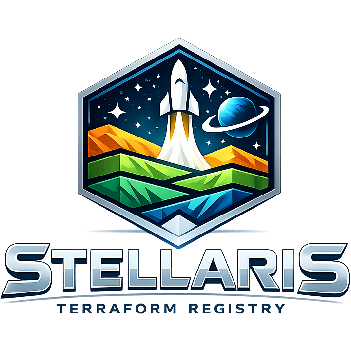

<p align="center">
  
</p>

<h1 align="center">Stellaris</h1>

<p align="center">
  <strong>Private Terraform/OpenTofu module and provider registry on Cloudflare Workers</strong>
</p>

<p align="center">
  <a href="#features">Features</a> &middot;
  <a href="#quick-start">Quick Start</a> &middot;
  <a href="#usage-with-terraform">Terraform Usage</a> &middot;
  <a href="#api-reference">API Reference</a> &middot;
  <a href="docs/API.md">Full API Docs</a>
</p>

---

Stellaris is a modern, edge-first private registry for [Terraform](https://www.terraform.io/) and [OpenTofu](https://opentofu.org/) modules and providers. It implements the official [Module Registry Protocol](https://developer.hashicorp.com/terraform/internals/module-registry-protocol) and [Provider Registry Protocol](https://developer.hashicorp.com/terraform/internals/provider-registry-protocol), so `terraform init` works natively — no wrappers, no plugins.

Built on [Cloudflare Workers](https://workers.cloudflare.com/), Stellaris runs entirely on the edge with no origin servers. Metadata lives in [Cloudflare D1](https://developers.cloudflare.com/d1/) (SQLite at edge), artifacts are stored in [Cloudflare R2](https://developers.cloudflare.com/r2/) (S3-compatible object storage), and the web UI is a full [Next.js](https://nextjs.org/) application served from the same Worker.

Inspired by the now-abandoned [Citizen](https://github.com/outsideris/citizen) project.

## Features

- **Full Terraform CLI compatibility** — `terraform init`, `terraform get`, and `terraform providers` work out of the box via the standard registry protocols
- **Module registry** — Publish, version, search, download, and delete Terraform modules
- **Provider registry** — Publish providers with multi-platform binaries, SHA256 checksums, and GPG signing keys
- **Web UI** — Browse modules and providers, view versions, search across your registry with a modern dark/light interface
- **Edge-first architecture** — Runs entirely on Cloudflare Workers with D1 for metadata and R2 for artifact storage; no origin servers
- **API key authentication** — SHA-256 hashed keys with optional expiration; bootstrap-friendly (first key requires no auth)
- **Dark & light themes** — Dracula Pro (dark, default) and Alucard Pro (light) via `next-themes`

## Quick Start

### Prerequisites

- [Node.js](https://nodejs.org/) 20+
- [pnpm](https://pnpm.io/) (package manager)
- A [Cloudflare account](https://dash.cloudflare.com/sign-up) (free tier works)

### 1. Clone and install

```bash
git clone https://github.com/hyvmind-io/stellaris.git
cd stellaris
pnpm install
```

### 2. Create Cloudflare resources

```bash
# Create the D1 database
npx wrangler d1 create stellaris-db

# Create the R2 bucket
npx wrangler r2 bucket create stellaris-modules
```

After creating the D1 database, copy the `database_id` from the output and update `wrangler.jsonc`:

```jsonc
"d1_databases": [
  {
    "binding": "DB",
    "database_name": "stellaris-db",
    "database_id": "your-actual-database-id"  // ← replace this
  }
]
```

### 3. Set up environment variables

Copy the example environment file:

```bash
cp .env.example .env.local
```

Edit `.env.local` with your values:

```env
NODE_ENV=development
NEXT_PUBLIC_APP_URL=http://localhost:3000
CLOUDFLARE_ACCOUNT_ID=your_account_id
CLOUDFLARE_DATABASE_ID=your_database_id
CLOUDFLARE_D1_TOKEN=your_d1_token
```

### 4. Initialize the local database

```bash
# Apply migrations and create a local dev API key
bash scripts/setup-local-db.sh
```

This creates all tables in the local D1 database and bootstraps a development API key:

```
stlr_0000000000000000000000000000000000000dev
```

> **Warning:** This key is for local development only. Never use it in production.

### 5. Start the dev server

```bash
pnpm dev
```

The registry is now running at [http://localhost:3000](http://localhost:3000).

## Configuration

### Environment Variables

| Variable                 | Description                                               | Default                 |
| ------------------------ | --------------------------------------------------------- | ----------------------- |
| `NODE_ENV`               | Runtime environment (`development`, `production`, `test`) | `development`           |
| `NEXT_PUBLIC_APP_URL`    | Public-facing URL of the registry                         | `http://localhost:3000` |
| `CLOUDFLARE_ACCOUNT_ID`  | Your Cloudflare account ID                                | —                       |
| `CLOUDFLARE_DATABASE_ID` | D1 database ID                                            | —                       |
| `CLOUDFLARE_D1_TOKEN`    | API token for D1 access                                   | —                       |

### Cloudflare Bindings (`wrangler.jsonc`)

| Binding           | Type          | Resource            | Purpose                                    |
| ----------------- | ------------- | ------------------- | ------------------------------------------ |
| `DB`              | D1 Database   | `stellaris-db`      | Module/provider metadata, API keys         |
| `MODULES_STORAGE` | R2 Bucket     | `stellaris-modules` | Module tarballs, provider zips, SHA256SUMS |
| `ASSETS`          | Static Assets | `.open-next/assets` | Next.js static files                       |

## Usage with Terraform

### 1. Configure credentials

Add your Stellaris registry to `~/.terraformrc` (or `%APPDATA%\terraform.rc` on Windows):

```hcl
credentials "stellaris.example.com" {
  token = "stlr_your_api_key_here"
}
```

> Replace `stellaris.example.com` with the domain where your Stellaris instance is deployed.

### 2. Use modules

Reference modules from your registry in Terraform configurations:

```hcl
module "vpc" {
  source  = "stellaris.example.com/myorg/vpc/aws"
  version = "1.0.0"

  # Module variables...
  cidr_block = "10.0.0.0/16"
}
```

### 3. Use providers

Declare providers from your registry:

```hcl
terraform {
  required_providers {
    custom = {
      source  = "stellaris.example.com/myorg/custom"
      version = "~> 1.0"
    }
  }
}

provider "custom" {
  # Provider configuration...
}
```

Terraform will automatically discover your registry's endpoints via the `/.well-known/terraform.json` service discovery document.

## API Reference

All write endpoints require authentication via the `Authorization: Bearer stlr_...` header. Read endpoints are public.

See the [full API documentation](docs/API.md) for detailed request/response examples.

### Service Discovery

| Method | Path                          | Description                 | Auth |
| ------ | ----------------------------- | --------------------------- | ---- |
| `GET`  | `/.well-known/terraform.json` | Terraform service discovery | No   |
| `GET`  | `/health`                     | Health check                | No   |

### Module Registry Protocol (Terraform CLI)

| Method | Path                                                     | Description                               | Auth |
| ------ | -------------------------------------------------------- | ----------------------------------------- | ---- |
| `GET`  | `/v1/modules/:namespace/:name/:system/versions`          | List module versions                      | No   |
| `GET`  | `/v1/modules/:namespace/:name/:system/:version/download` | Download module (204 + `X-Terraform-Get`) | No   |
| `GET`  | `/v1/modules/tarball/:path`                              | Serve module tarball from R2              | No   |

### Provider Registry Protocol (Terraform CLI)

| Method | Path                                                             | Description                           | Auth |
| ------ | ---------------------------------------------------------------- | ------------------------------------- | ---- |
| `GET`  | `/v1/providers/:namespace/:type/versions`                        | List provider versions with platforms | No   |
| `GET`  | `/v1/providers/:namespace/:type/:version/download/:os/:arch`     | Provider package metadata             | No   |
| `GET`  | `/v1/providers/:namespace/:type/:version/download/:os/:arch/zip` | Serve provider binary zip             | No   |
| `GET`  | `/v1/providers/:namespace/:type/:version/sha256sums`             | SHA256SUMS file                       | No   |
| `GET`  | `/v1/providers/:namespace/:type/:version/sha256sums.sig`         | SHA256SUMS GPG signature              | No   |

### Extended API

| Method   | Path                                            | Description                   | Auth        |
| -------- | ----------------------------------------------- | ----------------------------- | ----------- |
| `GET`    | `/v1/modules`                                   | List/search modules           | No          |
| `GET`    | `/v1/modules/:namespace/:name/:system`          | Latest module version         | No          |
| `GET`    | `/v1/modules/:namespace/:name/:system/:version` | Specific module version       | No          |
| `POST`   | `/v1/modules/:namespace/:name/:system/:version` | Publish module                | **Yes**     |
| `DELETE` | `/v1/modules/:namespace/:name/:system/:version` | Delete module version         | **Yes**     |
| `GET`    | `/v1/providers`                                 | List/search providers         | No          |
| `GET`    | `/v1/providers/:namespace/:type/:version`       | Specific provider version     | No          |
| `POST`   | `/v1/providers/:namespace/:type/:version`       | Publish provider              | **Yes**     |
| `DELETE` | `/v1/providers/:namespace/:type/:version`       | Delete provider version       | **Yes**     |
| `POST`   | `/v1/api-keys`                                  | Create API key                | Bootstrap\* |
| `GET`    | `/v1/api-keys`                                  | List API keys (metadata only) | **Yes**     |

\* The first API key can be created without authentication (bootstrap). All subsequent creations require a valid key.

## Publishing

### Publish a Module

**Step 1:** Create a tarball from your module directory. Exclude non-essential files to keep the size under the **50 MB** limit:

```bash
tar -czf my-module.tar.gz \
  --exclude='.terraform' \
  --exclude='.git' \
  --exclude='.jj' \
  --exclude='node_modules' \
  --exclude='.terragrunt-cache' \
  -C /path/to/your-module .
```

**Step 2:** Upload the tarball to the registry:

```bash
curl -X POST https://stellaris.example.com/v1/modules/myorg/vpc/aws/1.0.0 \
  -H "Authorization: Bearer stlr_your_api_key" \
  -F "module=@./my-module.tar.gz" \
  -F "owner=platform-team"
```

**Response** (`201 Created`):

```json
{
  "id": "myorg/vpc/aws/1.0.0",
  "namespace": "myorg",
  "name": "vpc",
  "provider": "aws",
  "version": "1.0.0",
  "owner": "platform-team",
  "published_at": "2026-02-18T12:00:00.000Z",
  "downloads": 0
}
```

> **Size limits:** Module tarballs must be under **50 MB**; provider zips must be under **64 MB** per platform. If your tarball exceeds the limit, check for `.terraform/` directories or other large artifacts that should be excluded.
>
> **curl tip:** The `@./` prefix means "file relative to the current directory". Using `@/filename` instead points to the filesystem root (`/filename`), which is almost certainly not what you want.

### Publish a Provider

Provider publishing requires a multipart form with the JSON metadata, platform binaries, and SHA256 signing artifacts:

```bash
curl -X POST https://stellaris.example.com/v1/providers/myorg/custom/1.0.0 \
  -H "Authorization: Bearer stlr_your_api_key" \
  -F 'data={
    "protocols": ["6.0"],
    "platforms": [
      {
        "os": "linux",
        "arch": "amd64",
        "shasum": "abc123...",
        "filename": "terraform-provider-custom_1.0.0_linux_amd64.zip"
      },
      {
        "os": "darwin",
        "arch": "arm64",
        "shasum": "def456...",
        "filename": "terraform-provider-custom_1.0.0_darwin_arm64.zip"
      }
    ],
    "gpg_public_keys": [
      {
        "key_id": "ABCD1234",
        "ascii_armor": "-----BEGIN PGP PUBLIC KEY BLOCK-----\n...\n-----END PGP PUBLIC KEY BLOCK-----",
        "source": "myorg",
        "source_url": "https://myorg.example.com/keys"
      }
    ]
  }' \
  -F "terraform-provider-custom_1.0.0_linux_amd64.zip=@./terraform-provider-custom_1.0.0_linux_amd64.zip" \
  -F "terraform-provider-custom_1.0.0_darwin_arm64.zip=@./terraform-provider-custom_1.0.0_darwin_arm64.zip" \
  -F "SHA256SUMS=@./SHA256SUMS" \
  -F "SHA256SUMS.sig=@./SHA256SUMS.sig"
```

### Bootstrap the First API Key

When no API keys exist, creation is allowed without authentication:

```bash
curl -X POST https://stellaris.example.com/v1/api-keys \
  -H "Content-Type: application/json" \
  -d '{"name": "admin", "description": "Initial admin key"}'
```

**Response** (`201 Created`):

```json
{
  "key": "stlr_a1b2c3d4e5f6...",
  "id": 1,
  "name": "admin",
  "description": "Initial admin key",
  "permissions": null,
  "created_at": "2026-02-18T12:00:00.000Z",
  "expires_at": null
}
```

> **Important:** The plaintext `key` is only returned once at creation time. Store it securely.

## Development

### Commands

| Command                | Description                                        |
| ---------------------- | -------------------------------------------------- |
| `pnpm dev`             | Start dev server with Turbopack                    |
| `pnpm build`           | Build for production                               |
| `pnpm preview`         | Build and preview with Cloudflare Workers locally  |
| `pnpm deploy`          | Build and deploy to Cloudflare Workers             |
| `pnpm test`            | Run tests with Vitest                              |
| `pnpm test:ui`         | Run tests with Vitest UI                           |
| `pnpm test:coverage`   | Run tests with coverage report                     |
| `pnpm lint`            | Lint with ESLint                                   |
| `pnpm type-check`      | TypeScript type checking                           |
| `pnpm db:generate`     | Generate Drizzle migrations from schema            |
| `pnpm db:setup`        | Apply migrations locally (via wrangler d1 execute) |
| `pnpm db:setup:remote` | Apply migrations to remote D1                      |
| `pnpm db:reset`        | Reset local database (wipes .wrangler/ state)      |
| `pnpm db:reset:remote` | Full reset of remote D1 (DESTRUCTIVE)              |
| `pnpm db:studio`       | Open Drizzle Studio (database GUI)                 |

### Project Structure

```
stellaris/
├── app/                        # Next.js App Router
│   ├── .well-known/            # Terraform service discovery
│   ├── health/                 # Health check endpoint
│   ├── modules/                # Module browse UI pages
│   ├── providers/              # Provider browse UI pages
│   ├── v1/                     # API route handlers
│   │   ├── api-keys/           #   API key management
│   │   ├── modules/            #   Module registry endpoints
│   │   └── providers/          #   Provider registry endpoints
│   ├── layout.tsx              # Root layout (themes, header, footer)
│   ├── page.tsx                # Homepage / dashboard
│   └── globals.css             # Tailwind CSS + theme variables
├── components/                 # React components
│   ├── layout/                 #   Header, footer
│   ├── ui/                     #   shadcn/ui primitives
│   └── *.tsx                   #   Registry-specific components
├── db/                         # Database layer
│   ├── schema.ts               #   Drizzle ORM schema (5 tables)
│   └── client.ts               #   D1 client factory
├── drizzle/                    # Generated SQL migrations
├── lib/                        # Shared library code
│   ├── api/                    #   Response helpers, error factories
│   ├── auth/                   #   API key generation, hashing, middleware
│   ├── data/                   #   Data access (modules, providers, stats)
│   ├── storage/                #   R2 storage (upload, download, delete)
│   ├── validation/             #   Zod schemas for all routes
│   └── utils/                  #   Version comparison, general utilities
├── scripts/                    # Setup scripts
│   └── setup-local-db.sh       #   Local D1 + dev API key bootstrap
├── __tests__/                  # Vitest test suites
├── wrangler.jsonc              # Cloudflare Workers config
├── open-next.config.ts         # OpenNext.js adapter config
├── drizzle.config.ts           # Drizzle Kit config
└── package.json
```

## Deployment

Stellaris deploys to Cloudflare Workers via the [OpenNext.js Cloudflare adapter](https://opennext.js.org/cloudflare):

```bash
pnpm deploy
```

This runs `opennextjs-cloudflare build && opennextjs-cloudflare deploy`, which:

1. Builds the Next.js application
2. Bundles it as a Cloudflare Worker
3. Deploys the Worker, D1 bindings, and R2 bindings to your Cloudflare account

Make sure your `wrangler.jsonc` has the correct `database_id` and that the R2 bucket exists before deploying.

### Apply database migrations in production

```bash
pnpm db:setup:remote
```

## Architecture

```
┌─────────────────────────────────────────────────────────────┐
│                    Cloudflare Edge Network                    │
│                                                              │
│  ┌──────────────────────────────────────────────────────┐   │
│  │                 Cloudflare Worker                      │   │
│  │                                                        │   │
│  │  ┌─────────────┐    ┌──────────────────────────────┐  │   │
│  │  │  Next.js     │    │  API Route Handlers          │  │   │
│  │  │  App Router  │    │  (Terraform Protocol +       │  │   │
│  │  │  (Web UI)    │    │   Extended API)              │  │   │
│  │  └─────────────┘    └──────────────────────────────┘  │   │
│  │         │                        │                     │   │
│  │         └────────┬───────────────┘                     │   │
│  │                  │                                     │   │
│  │         ┌────────▼────────┐                            │   │
│  │         │  Drizzle ORM    │                            │   │
│  │         │  (Data Layer)   │                            │   │
│  │         └────────┬────────┘                            │   │
│  │                  │                                     │   │
│  │    ┌─────────────┴─────────────┐                      │   │
│  │    │                           │                      │   │
│  │    ▼                           ▼                      │   │
│  │  ┌──────────┐          ┌──────────────┐               │   │
│  │  │ D1       │          │ R2           │               │   │
│  │  │ (SQLite) │          │ (Object      │               │   │
│  │  │ Metadata │          │  Storage)    │               │   │
│  │  └──────────┘          └──────────────┘               │   │
│  │   5 tables:              Artifacts:                    │   │
│  │   modules                modules/*.tar.gz              │   │
│  │   providers              providers/*.zip               │   │
│  │   provider_platforms     SHA256SUMS                     │   │
│  │   gpg_public_keys        SHA256SUMS.sig                │   │
│  │   api_keys                                             │   │
│  └──────────────────────────────────────────────────────┘   │
└─────────────────────────────────────────────────────────────┘
```

**Request flow:**

1. Terraform CLI (or HTTP client) sends a request to the Worker
2. Next.js App Router matches the route to an API handler or page
3. API handlers validate input with Zod schemas
4. Data layer queries D1 via Drizzle ORM for metadata
5. Storage layer reads/writes artifacts to R2
6. Response is returned in the format Terraform CLI expects

## License

Copyright &copy; 2026 Evandro Camargo. All rights reserved.

See [LICENSE](LICENSE) for details.

## Credits

- Inspired by [Citizen](https://github.com/outsideris/citizen)
- Built with [Next.js](https://nextjs.org/), [Cloudflare Workers](https://workers.cloudflare.com/), [Drizzle ORM](https://orm.drizzle.team/), and [shadcn/ui](https://ui.shadcn.com/)
- Deployed via [OpenNext.js](https://opennext.js.org/cloudflare) Cloudflare adapter
